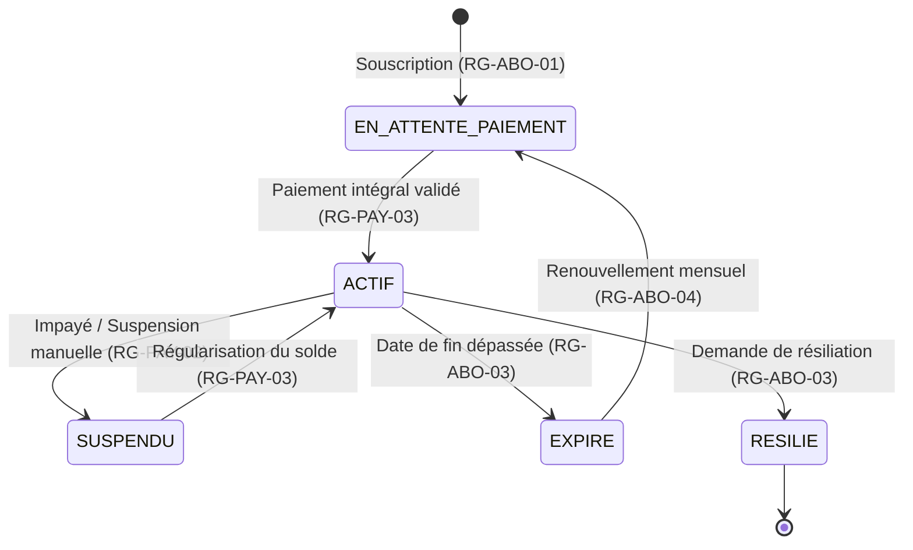
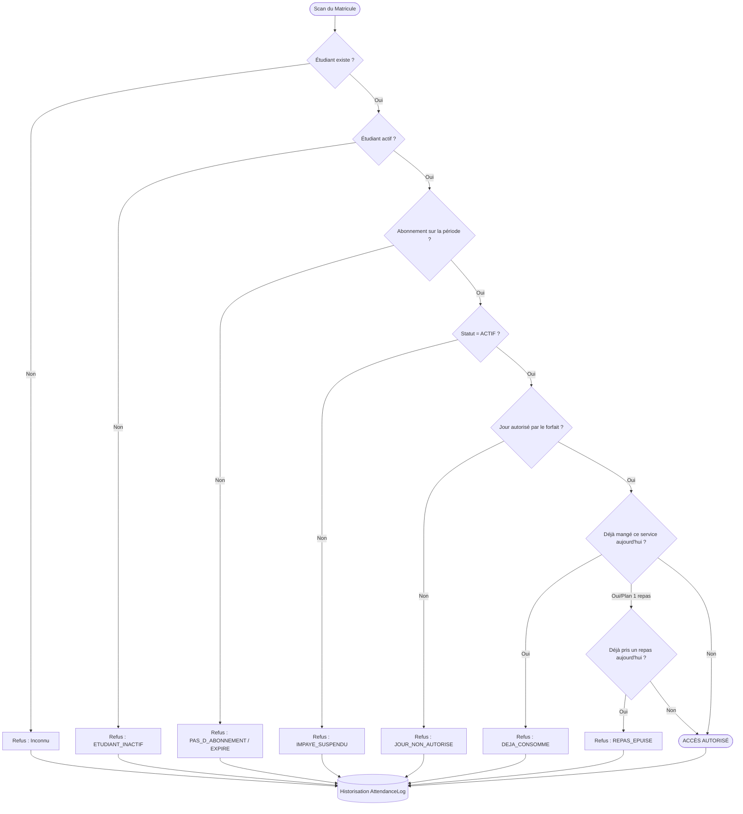

# Cahier des Charges & Spécifications Fonctionnelles
## Système de Gestion de Cantine Scolaire — CantineMaster

> **Public cible :** Projet Pédagogique — Module *Test et Validation des Logiciels*  
> **Auteur :** Antigravity / Équipe Pédagogique  
> **Version :** 1.0.0  
> **Statut :** Validé pour Recette Logicielle  

---

## 1. Contexte & Objectifs du Projet

### 1.1 Contexte Général
Dans un établissement scolaire (collège, lycée, enseignement supérieur), la gestion de la restauration collective implique des flux quotidiens importants, des contraintes budgétaires et un impératif de traçabilité.  
Le projet **CantineMaster** vise à informatiser l'ensemble de la chaîne de restauration :
- L'administration des personnels et des habilitations internes.
- La gestion des dossiers étudiants et de leurs formules de cantine.
- La gestion des souscriptions mensuelles renouvelables et de leurs échéances.
- Le suivi des encaissements et la facturation.
- Le contrôle d'accès physique au réfectoire par borne tactile/scan de badge en temps réel.

### 1.2 Objectif Pédagogique (Test & Validation)
Ce document sert de **référentiel d'exigences (Software Requirements Specification - SRS)** pour les étudiants.  
Toutes les règles de gestion y sont formalisées et codifiées (identifiants uniques `RG-...`). L'objectif des étudiants est de :
1. Analyser ces exigences pour en déduire des cas de test complets.
2. Établir une **matrice de traçabilité des exigences**.
3. Appliquer les techniques formelles de test (Partitions d'équivalence, Analyse des valeurs limites, Tables de décision).
4. Évaluer la conformité de l'application livrée et automatiser sa recette via **Pytest**.

---

## 2. Acteurs du Système & Matrice des Droits (RBAC)

Le système distingue trois profils d'utilisateurs internes et un bénéficiaire final :

| Acteur | Code Rôle | Responsabilités & Périmètre |
| :--- | :--- | :--- |
| **Administrateur** | `ADMIN` | Direction / DSI. Crée les comptes utilisateurs, gère les rôles, active/désactive les accès, accès à l'ensemble du système. |
| **Gestionnaire** | `GESTIONNAIRE` | Service intendance / vie scolaire. Inscrit les étudiants, gère les abonnements, encaisse les règlements, édite les reçus. |
| **Agent de Cantine** | `AGENT_POINTAGE` | Personnel en poste au réfectoire. Utilise la borne de pointage, valide les passages, consulte l'historique du jour. |
| **Étudiant (Bénéficiaire)** | *Aucun compte direct* | Bénéficiaire des repas. Ne se connecte pas au système administratif. Dispose d'un matricule unique (`ETU-XXXXX`). |

### Matrice d'Habilitation par Fonctionnalité

| Fonctionnalité / URL | Public (Non authentifié) | `AGENT_POINTAGE` | `GESTIONNAIRE` | `ADMIN` |
| :--- | :---: | :---: | :---: | :---: |
| Page de connexion (`/login`) | ✅ Autorisé | ✅ Autorisé | ✅ Autorisé | ✅ Autorisé |
| Tableau de bord (`/`) | ❌ Redirection | ✅ Lecture seule | ✅ Autorisé | ✅ Autorisé |
| Borne de pointage (`/attendance/`) | ❌ Redirection | ✅ Autorisé | ✅ Autorisé | ✅ Autorisé |
| Gestion des étudiants (`/students/`) | ❌ Redirection | ❌ Interdit (403) | ✅ Autorisé | ✅ Autorisé |
| Gestion des abonnements (`/subscriptions/`) | ❌ Redirection | ❌ Interdit (403) | ✅ Autorisé | ✅ Autorisé |
| Caisse & Paiements (`/payments/`) | ❌ Redirection | ❌ Interdit (403) | ✅ Autorisé | ✅ Autorisé |
| Gestion des utilisateurs (`/users/`) | ❌ Redirection | ❌ Interdit (403) | ❌ Interdit (403) | ✅ Autorisé |

---

## 3. Règles de Gestion Détaillées (RG)

### 3.1 Authentification & Gestion des Utilisateurs (`RG-USR`)

- **`RG-USR-01` : Authentification Obligatoire**  
  Toute route du système (à l'exception de `/login`) nécessite une session utilisateur active. Tout accès anonyme doit être intercepté et redirigé vers `/login`.
- **`RG-USR-02` : Absence d'Auto-Inscription Publique**  
  Le système n'expose aucun formulaire d'inscription en libre-service. La création de tout nouvel utilisateur est exclusivement réalisée depuis l'interface d'administration par un utilisateur ayant le rôle `ADMIN`.
- **`RG-USR-03` : Unicité des Identifiants**  
  Le nom d'utilisateur (`username`) et l'adresse email doivent être uniques dans toute la base. Le nom d'utilisateur doit être composé de 3 à 30 caractères alphanumériques (tirets et underscores autorisés).
- **`RG-USR-04` : Politique de Complexité des Mots de Passe**  
  Tout mot de passe doit comporter **au minimum 8 caractères**, incluant **au moins une lettre** et **au moins un chiffre**. Les mots de passe sont stockés sous forme hachée sécurisée (PBKDF2/SHA256).
- **`RG-USR-05` : Contrôle d'Accès basé sur les Rôles (RBAC)**  
  Toute tentative d'accès à un module non autorisé pour le rôle de l'utilisateur connecté doit renvoyer une erreur HTTP `403 Forbidden`.
- **`RG-USR-06` : Révocation d'Accès (Comptes Désactivés)**  
  Un compte utilisateur désactivé (`is_active = False`) ne peut plus s'authentifier. Un message explicite doit lui être affiché. Un administrateur ne peut pas désactiver son propre compte.
- **`RG-USR-07` : Compte d'Amorçage (Bootstrap)**  
  La commande d'initialisation (`flask seed`) initialise obligatoirement un compte administrateur racine (`admin` / `Admin123!`).

---

### 3.2 Gestion des Dossiers Étudiants (`RG-ETU`)

- **`RG-ETU-01` : Format et Unicité du Matricule**  
  Le matricule est obligatoire, immuable après création, et doit respecter strictement le format regex : `^ETU-\d{5}$` (Exemple : `ETU-10042`).
- **`RG-ETU-02` : Validité et Unicité de l'Email Étudiant**  
  L'adresse email doit avoir une syntaxe valide (RFC 5322 simplifiée) et être unique parmi tous les étudiants enregistrés.
- **`RG-ETU-03` : Intégrité du Statut Étudiant**  
  Un étudiant inactif (`is_active = False`) ne peut ni souscrire à un nouvel abonnement, ni badger au réfectoire.
- **`RG-ETU-04` : Champs Obligatoires**  
  Le prénom, le nom et la classe de l'étudiant sont obligatoires et ne peuvent être constitués de simples espaces blancs.

---

### 3.3 Gestion des Abonnements Mensuels (`RG-ABO`)

- **`RG-ABO-01` : Période de Validité**  
  Tout abonnement est défini par une `start_date` et une `end_date`. La date de fin doit être postérieure ou égale à la date de début (`end_date >= start_date`). La durée par défaut est de 30 jours calendaires.
- **`RG-ABO-02` : Interdiction des Chevauchements d'Abonnements**  
  Pour un étudiant donné, il est rigoureusement interdit de créer deux abonnements dont les plages de dates se chevauchent s'ils sont à l'état `ACTIF` ou `EN_ATTENTE_PAIEMENT`.
- **`RG-ABO-03` : Cycle de Vie & Statuts d'un Abonnement**  
  Un abonnement traverse les états suivants :
  - `EN_ATTENTE_PAIEMENT` : Créé mais non encore totalement réglé.
  - `ACTIF` : Intégralement réglé et en cours de validité.
  - `SUSPENDU` : Suspendu manuellement ou pour défaut de paiement.
  - `EXPIRE` : La date courante a dépassé `end_date`.
  - `RESILIE` : Annulé définitivement par le gestionnaire.
- **`RG-ABO-04` : Renouvellement Périodique**  
  L'action de renouvellement génère un nouvel abonnement pour le mois suivant, débutant le lendemain (`end_date + 1 jour`) du précédent, initialement à l'état `EN_ATTENTE_PAIEMENT`.
- **`RG-ABO-05` : Formules Disponibles (Plans)**  
  Une formule définit :
  - Un tarif mensuel en euros (`price_monthly > 0`).
  - Une liste de jours de la semaine autorisés (ex : 4 jours = Lundi, Mardi, Jeudi, Vendredi ; 5 jours = Lundi au Vendredi ; 7 jours = semaine complète).
  - Un nombre de repas autorisés par jour (1 pour Déjeuner seul, 2 pour Déjeuner + Dîner).

---

### 3.4 Encaissements & Suivi des Paiements (`RG-PAY`)

- **`RG-PAY-01` : Exigibilité Financière**  
  Tout abonnement souscrit engendre une créance égale au montant mensuel de la formule choisie.
- **`RG-PAY-02` : Positivité Stricte du Règlement**  
  Le montant d'un paiement doit être un nombre strictement supérieur à zéro (`amount > 0.00 €`). Tout montant négatif ou nul doit être rejeté.
- **`RG-PAY-03` : Règlements Partiels et Activation Automatique**  
  Les paiements échelonnés sont autorisés. Dès lors que la somme des paiements validés atteint ou dépasse le tarif de l'abonnement, le statut de l'abonnement bascule automatiquement de `EN_ATTENTE_PAIEMENT` (ou `SUSPENDU`) vers `ACTIF`.
- **`RG-PAY-04` : Traçabilité et Quittance de Paiement**  
  Chaque encaissement génère une référence unique (`PAY-YYYYMMDD-XXXXXX`) et un numéro de quittance (`REC-YYYYMM-XXXXX`) permettant l'impression d'un reçu fiscal/justificatif officiel.
- **`RG-PAY-05` : Modes de Paiement Reconnus**  
  Les seuls modes autorisés sont : `CARTE` (Carte Bancaire), `ESPECES` (Espèces), `VIREMENT` (Virement bancaire), `CHEQUE` (Chèque).

---

### 3.5 Contrôle d'Accès & Fréquentation Cantine (`RG-FRQ`)

- **`RG-FRQ-01` : Services de Restauration**  
  Deux services quotidiens sont gérés :
  - `DEJEUNER` (Midi)
  - `DINER` (Soir)
- **`RG-FRQ-02` : Conditions Strictes d'Autorisation de Passage**  
  L'accès au réfectoire est accordé (**`AUTORISÉ`**) si et seulement si l'ensemble des conditions suivantes sont simultanément vérifiées :
  1. Le matricule correspond à un étudiant enregistré en base.
  2. Le dossier de l'étudiant est actif (`is_active = True`).
  3. L'étudiant possède un abonnement couvrant la date du jour (`start_date <= aujourd'hui <= end_date`).
  4. L'abonnement est dans l'état `ACTIF`.
  5. Le jour de la semaine du passage est inclus dans les jours autorisés par la formule souscrite.
  6. L'étudiant n'a pas encore consommé de repas autorisé pour ce même service au cours de la journée.
  7. Le quota de repas journaliers du forfait n'est pas épuisé.
- **`RG-FRQ-03` : Motifs de Refus Normalisés**  
  En cas de non-respect d'au moins une condition, l'accès est refusé (**`REFUSÉ`**) avec l'un des motifs standardisés suivants :
  - `ETUDIANT_INACTIF` : Dossier administratif désactivé.
  - `PAS_D_ABONNEMENT` : Aucun abonnement trouvé pour cet étudiant.
  - `ABONNEMENT_EXPIRE` : Date de fin d'abonnement échue.
  - `IMPAYE_SUSPENDU` : Abonnement bloqué pour défaut de paiement.
  - `JOUR_NON_AUTORISE` : Jour de passage non prévu par la formule (ex: mercredi sur formule 4 jours).
  - `DEJA_CONSOMME` : L'étudiant a déjà validé un passage sur ce service aujourd'hui.
  - `REPAS_EPUISE` : Le quota journalier de repas du forfait est atteint.
- **`RG-FRQ-04` : Audit Trail (Journalisation Intégrale)**  
  Toute tentative de pointage (qu'elle soit autorisée ou refusée) fait l'objet d'un enregistrement horodaté dans la table d'audit `attendance_logs`, conservant le matricule, l'heure à la seconde près, le résultat et l'identifiant de l'agent ou de la borne ayant effectué la lecture.

---

## 4. Diagrammes des Flux & Cycle de Vie

### 4.1 Cycle de Vie d'un Abonnement

### 4.2 Algorithme de Décision du Pointage Réfectoire

---

## 5. Dictionnaire des Données

| Entité | Attribut | Type | Contraintes | Description |
| :--- | :--- | :--- | :--- | :--- |
| **User** | `id` | Integer | Clé primaire | Identifiant technique |
| | `username` | Varchar(64) | Unique, Not Null | Login de connexion (3-30 car.) |
| | `email` | Varchar(120) | Unique, Not Null | Email professionnel |
| | `password_hash`| Varchar(256) | Not Null | Hash PBKDF2 du mot de passe |
| | `full_name` | Varchar(100) | Not Null | Nom et prénom |
| | `role` | Varchar(30) | Not Null | `ADMIN`, `GESTIONNAIRE`, `AGENT_POINTAGE` |
| | `is_active` | Boolean | Not Null, Def=True | Compte actif ou suspendu |
| **Student** | `id` | Integer | Clé primaire | Identifiant technique |
| | `matricule` | Varchar(20) | Unique, Not Null, Index | Format `ETU-XXXXX` |
| | `first_name` | Varchar(60) | Not Null | Prénom de l'élève |
| | `last_name` | Varchar(60) | Not Null | Nom de famille |
| | `email` | Varchar(120) | Unique, Not Null | Email scolaire de l'élève |
| | `class_name` | Varchar(50) | Not Null | Promotion / Division |
| | `is_active` | Boolean | Not Null, Def=True | Élève inscrit et actif |
| **SubscriptionPlan** | `id` | Integer | Clé primaire | Identifiant formule |
| | `code` | Varchar(30) | Unique, Not Null | Code interne (ex: `PT_5J`) |
| | `name` | Varchar(100) | Not Null | Nom commercial de la formule |
| | `price_monthly`| Float | Not Null, > 0 | Tarif mensuel en euros |
| | `days_allowed` | Varchar(20) | Not Null | Jours (ex: `"0,1,2,3,4"`) |
| | `meals_per_day`| Integer | Not Null, Def=1 | Nb repas quotidiens max |
| **Subscription** | `id` | Integer | Clé primaire | Identifiant abonnement |
| | `student_id` | Integer | FK students.id | Élève abonné |
| | `plan_id` | Integer | FK subscription_plans.id | Formule souscrite |
| | `start_date` | Date | Not Null | Date début de validité |
| | `end_date` | Date | Not Null, >= start | Date fin de validité |
| | `status` | Varchar(30) | Not Null | `ACTIF`, `EN_ATTENTE_PAIEMENT`, `SUSPENDU`, `EXPIRE`, `RESILIE` |
| | `auto_renew` | Boolean | Not Null, Def=True | Renouvellement tacite |
| **Payment** | `id` | Integer | Clé primaire | Identifiant règlement |
| | `subscription_id`| Integer | FK subscriptions.id | Abonnement acquitté |
| | `student_id` | Integer | FK students.id | Élève payeur |
| | `amount` | Float | Not Null, > 0 | Montant versé en euros |
| | `payment_date`| Date | Not Null | Date de versement |
| | `payment_method`| Varchar(20) | Not Null | `CARTE`, `ESPECES`, `VIREMENT`, `CHEQUE` |
| | `reference` | Varchar(64) | Unique, Not Null | Réf interne de transaction |
| | `receipt_number`| Varchar(64) | Unique | Numéro de reçu officiel |
| **AttendanceLog** | `id` | Integer | Clé primaire | Identifiant passage |
| | `student_id` | Integer | FK students.id | Élève scanné |
| | `timestamp` | DateTime | Not Null, Index | Date et heure précise du passage |
| | `service_type` | Varchar(20) | Not Null | `DEJEUNER`, `DINER` |
| | `status` | Varchar(20) | Not Null | `AUTORISE` ou `REFUSE` |
| | `refusal_reason`| Varchar(50) | Nullable | Code standardisé en cas de rejet |
| | `scanned_by_user_id`| Integer | FK users.id, Nullable | Agent ayant validé le passage |
